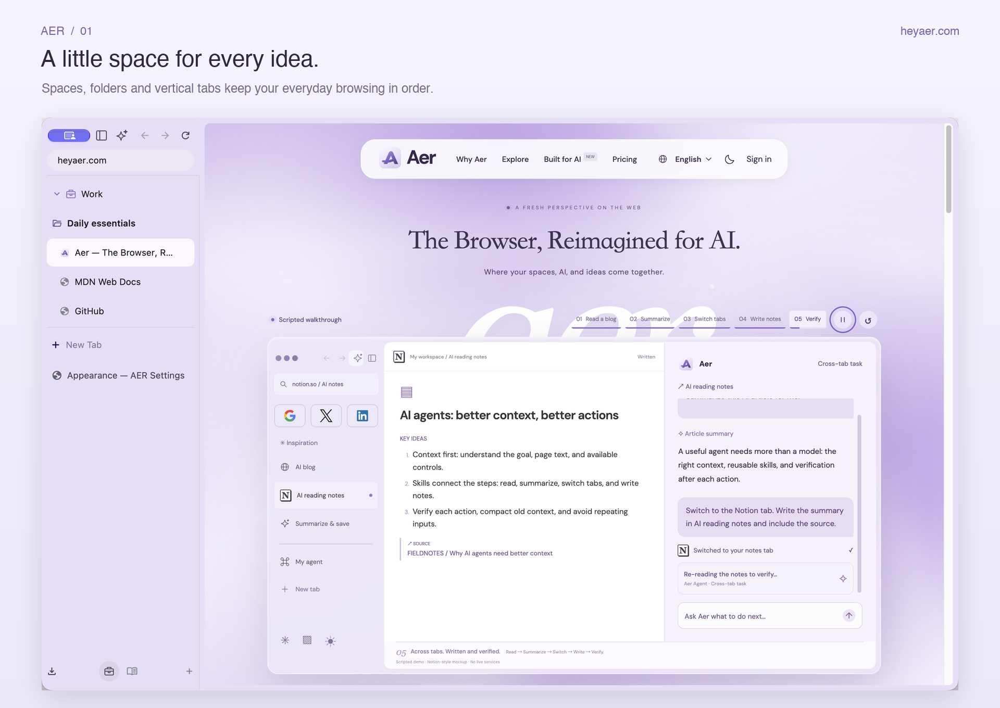
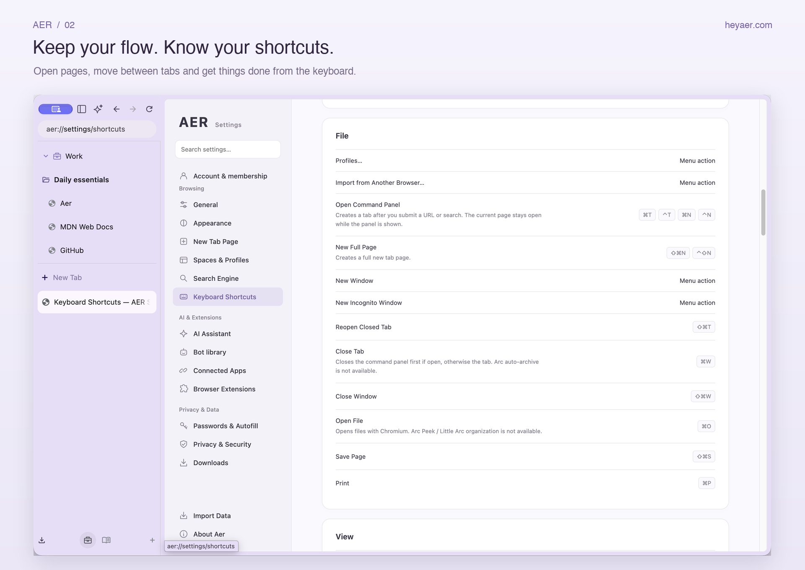
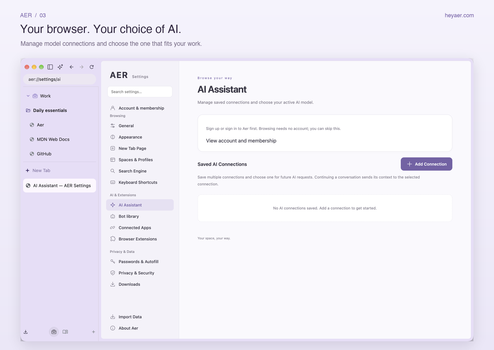
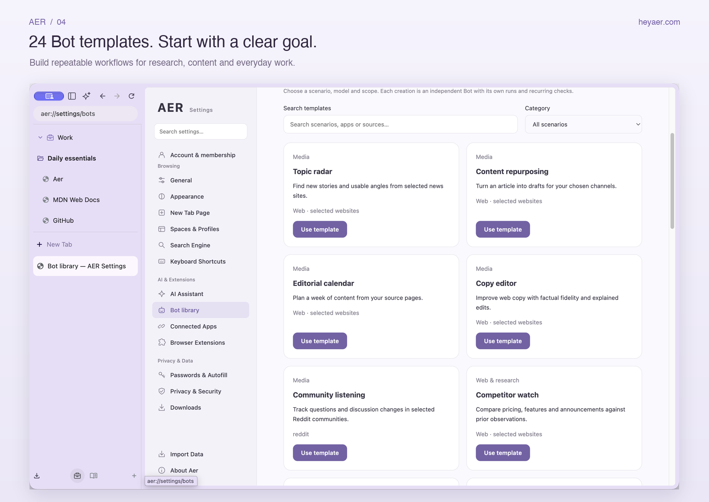
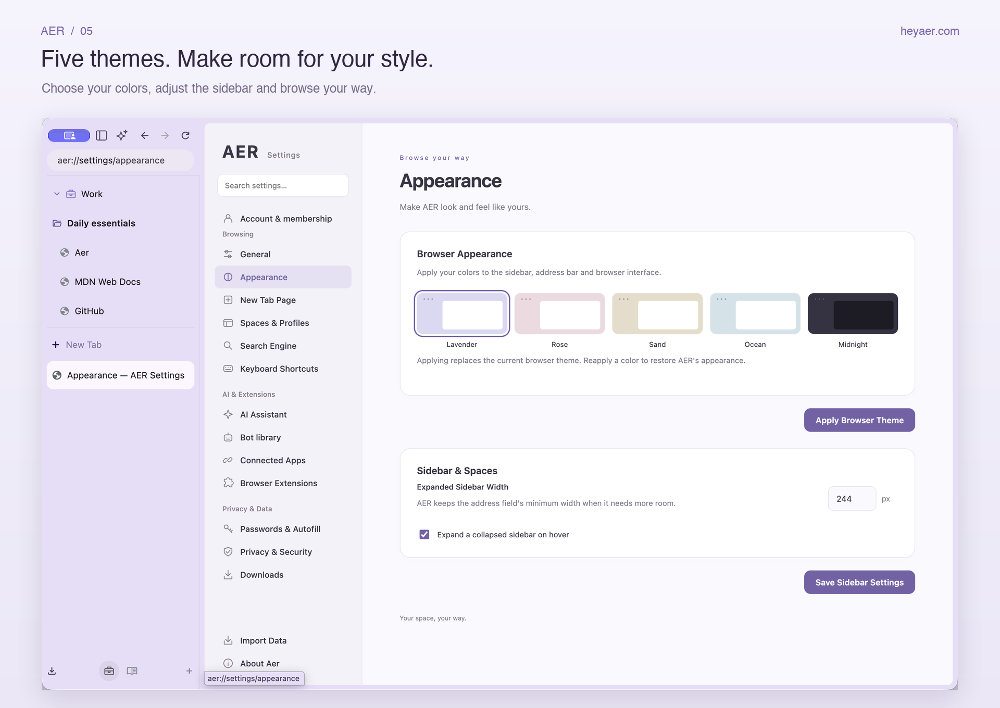

<p align="center">
  
</p>

<h1 align="center">Aer 浏览器</h1>
<p align="center"><strong>把网页、AI 和你的工作，放回同一个地方。</strong></p>
<p align="center">A Chromium browser for macOS, built around your workspace and AI.</p>
<p align="center">
  <a href="https://heyaer.com">官网 heyaer.com</a> ·
  <a href="https://github.com/astaxie/heyaer/releases/latest">下载 Aer</a> ·
  <a href="#安装-aer-browser-skill">安装浏览器 Skill</a> ·
  <a href="https://github.com/astaxie/heyaer/issues">反馈问题</a>
</p>



Aer 面向每天在浏览器里阅读、研究、写作和协作的人。用空间整理不同项目，把常用网页放在顺手的位置；需要理解材料时，在网页旁调用 AI；需要持续跟进时，用 Bot 和应用连接器处理明确授权的工作。

它采用 Chromium 内核与原生 macOS 界面，保留熟悉的网页浏览和扩展生态，同时加入垂直标签、空间、分屏、命令窗、网页 AI、Bot 与本地资料归档。你可以先把 Aer 当作日常浏览器，再按需要接入 AI。

本仓库提供官方安装包、自动更新、产品截图与可单独安装的 `aer-browser` skill。浏览器应用源码在独立仓库维护。

## 下载与开始使用

**支持 Apple Silicon Mac（M 系列芯片），macOS 13 或更新版本。** 当前发行包不适用于 Intel Mac、Windows 或 Linux。

1. 打开 [最新发行版](https://github.com/astaxie/heyaer/releases/latest)，下载名称以 `-mac-arm64.dmg` 结尾的安装包。
2. 打开 DMG，把 **AER.app** 拖入「应用程序」。如果已安装 Aer，先正常退出旧版再替换。
3. 启动 Aer。基础浏览无需登录；你可以先创建工作空间、导入书签，或安装常用扩展。
4. 需要 AI 时，在 **设置 → 账号与会员** 查看可用权限，再到 **AI 助手** 配置模型连接。

发行包使用 Apple Developer ID 签名并经过 Apple 公证。带更新功能的版本每天自动检查 GitHub 更新，也可以选择 **Aer → 检查更新…**；安装新版需要你的确认。尚未内置更新功能的旧版本，先手动安装一次新版即可。下载安装包不需要 GitHub 账号。

[访问官网，了解 Aer 的产品与方案 →](https://heyaer.com)

## Aer 能帮你做什么

| 你正在做的事 | Aer 提供的能力 | 带来的好处 |
| --- | --- | --- |
| 同时推进多个项目 | Spaces、垂直标签、共享置顶、收藏文件夹 | 把项目上下文分开，减少在标签堆里寻找网页 |
| 对照阅读和整理资料 | 原生左右分屏、标签拖放 | 两个网页一起看，减少来回切换 |
| 快速访问网页与提问 | 访问／搜索／询问 AI 命令窗 | 一个入口完成找网页、切标签和发起问题 |
| 阅读长文、外文与多份材料 | 网页 AI、最多 8 个标签引用、总结／翻译／提取 | 在材料旁获得解释和结构化结果，少一些复制粘贴 |
| 起草回复与填写资料 | 回复草稿、表单填写预览 | 先检查再应用，保留对最终内容的控制 |
| 跟进重复事务 | 24 个 Bot 模板、独立目标、记忆、定时运行与执行记录 | 把一次性提问变成可以重复使用的任务配置 |
| 处理分散在应用里的信息 | 20 个应用连接器、账号和资源范围选择 | 围绕指定资料开展工作，减少跨应用查找 |
| 留存值得反复阅读的网页 | Markdown、整页 PNG、公众号图文到 Obsidian | 把临时阅读变成自己的可检索资料 |
| 让 Codex 使用正在浏览的页面 | 独立 `aer-browser` skill 与应用内原生 CLI | 让外部 AI 助手使用你选定的浏览器会话和网页 |
| 换浏览器、保留习惯 | Safari／Chrome／Arc 导入、Chrome 扩展、主题与快捷键 | 用熟悉的工具和资料开始使用 Aer |

### 给每一种工作，一个空间

- **垂直标签**：完整标题更容易辨认，适合同时打开多份资料。
- **Spaces**：给工作、阅读或不同项目命名，选择图标与颜色，通过底部空间栏切换。
- **共享置顶**：常用网站跨空间保留；普通标签、收藏和文件夹按空间整理。
- **文件夹与拖放**：整理收藏层级，调整顺序，把网页移到合适的位置。
- **左右分屏**：把两个现有网页并排查看，适合对照文档、比较产品或边看资料边工作。
- **浏览器资料（Profile）**：需要不同账号环境时使用独立资料。Space 用于整理工作，并不隔离 Cookie 和登录状态；不要把两者混为一谈。

### 一个命令窗，接住下一步



按 **⌘N** 打开命令窗，直接输入网址、搜索内容或切换到 AI 提问。已经打开的网页可以从结果中直接切回，免去重新寻找标签的过程。

| 常用操作 | macOS 快捷键 |
| --- | --- |
| 打开命令窗 | `⌘N` |
| 输入或修改网址 | `⌘L` |
| 新建标签页 | `⇧⌘N` |
| 打开／关闭 AI 对话 | `⌥⌘G` |

### AI 就在你正在阅读的材料旁边



右侧 AI 面板支持流式回答、连续追问、新对话和停止生成。通过 `@` 搜索并引用已打开的网页，最多选择 8 个标签进行跨页面分析，例如比较几份方案、归纳不同来源的观点，或把长文转成行动清单。

| 内置命令 | 用途 |
| --- | --- |
| `/summarize` | 总结当前引用的网页；多页可一起归纳 |
| `/translate` | 翻译与解读网页内容 |
| `/extract` | 提取关键事实、结论与待办 |
| `/reply` | 结合网页上下文起草回复，供你检查和使用 |
| `/fill` | 生成普通网页表单的填写预览，经你确认后应用 |

AI 助手支持保存多个模型连接，配置服务地址、模型 ID 与 API Key，获取模型列表并测试连接。你可以使用兼容的自有模型服务；模型调用由所选服务提供，费用与使用规则遵循该服务。

AI 分析会把本次选中的网页上下文发送给所选模型服务。长网页会按上下文预算节选。表单填写先展示预览，不自动提交表单，也不处理密码、验证码和支付字段。

### 把重复工作，配置成自己的 Bot



从 **设置 → Bot 库** 选择模板，填写目标、资料范围和模型连接，再决定何时运行。同一模板可以创建多份独立 Bot，分别维护目标、资源、记忆、运行安排和历史结果。

24 个内置模板覆盖五类常见工作：

| 场景 | 模板 |
| --- | --- |
| 内容与媒体运营 | 媒体选题雷达、一稿多平台、内容排期策划、文案编辑、社区话题观察 |
| 网站与研究 | 竞品变化监测、SEO 内容简报、网站内容巡检、研究与事实核对 |
| 日常工作 | 邮箱重点摘要、日程与会前准备、会议纪要与行动项、待办优先级整理、团队讨论摘要 |
| 产品与项目 | 项目风险跟进、代码评审队列、需求范围简报、问题反馈归纳 |
| 销售与运营 | 客户线索研究、客户跟进清单、表格经营简报、活动邀约评估、办公室事务跟进、订阅服务复盘 |

你可以手动运行，或设置间隔、每天、每周与时区。结果和过程保存在对应 Bot 的执行记录中；“对话”“智能体”“消息”分别承接临时问答、长期任务和历史结果。

定时任务依赖这台 Mac 上的 Aer 继续运行；退出应用或电脑休眠时暂停。模板主要提供读取、分析、提醒与草稿，具体操作取决于已经接入的工具和你的授权，不意味着自动具备发邮件、发帖或修改所有业务系统的能力。

### 连接你选择的应用与资料

Aer 提供 20 个应用连接器入口，可以围绕指定账号、仓库、文档、频道、项目或日历开展工作。

| 工作领域 | 应用 |
| --- | --- |
| 知识与文档 | Notion、Google Drive、Google Docs、Google Sheets、OneDrive、Dropbox |
| 开发与项目 | GitHub、Linear、Asana、Trello、ClickUp、Airtable、Todoist |
| 邮件与日程 | Gmail、Outlook、Google Calendar |
| 团队与社区 | Slack、Microsoft Teams、Discord、Reddit |

在 **设置 → 应用连接** 中选择服务并配置连接。支持的方式依服务而定，包括 Token、凭据或 OAuth；需要 OAuth 的服务须具备相应授权配置。连接成功后，再给任务选择具体资源和允许的操作。每个服务开放的动作不同，连接账号并不等于授予整个账号的无限权限。

### 把看过的网页，留在自己的资料库

Aer 内置三个本地导出入口，也可以从下方的浏览器 skill 调用：

| 命令 | 保存结果 | 适合的场景 |
| --- | --- | --- |
| `/markdown` | 保留标题、段落、列表、代码、表格、来源等结构的 Markdown | 阅读笔记、研究资料、文档归档 |
| `/screenshot` | 自动滚动并生成整页 PNG，随后恢复阅读位置 | 保存页面布局、分享长文与网页留档 |
| `/wechat` | 公众号正文 Markdown 与本地图片，写入所选 Obsidian 仓库 | 公众号文章剪藏、离线阅读和长期积累 |

这些导出在本地执行，不调用大模型。Markdown 和 PNG 默认进入“下载 / Aer Exports”；公众号剪藏先选择已有 Obsidian 仓库。页面需要你能正常打开和阅读，登录或验证由你在网页中完成。内嵌滚动区、虚拟列表和页面未加载的内容可能需要额外处理。

### 保留熟悉的工具，也保留你的审美



- **五套主题**：鸢尾、蔷薇、沙丘、海盐、夜航，覆盖明亮和深色浏览环境。
- **可调侧栏**：调整宽度，收起后可通过鼠标悬停展开。
- **新标签页**：可配置背景、快捷入口、待办与新闻来源，把首页整理成自己的起点。
- **Chrome 扩展生态**：通过 Chrome Web Store 安装支持的扩展，保留原生权限确认。具体兼容性取决于扩展和当前版本。
- **分享网页画面**：截图预览支持背景配色、横竖构图、留白与圆角，可复制到剪贴板，方便分享当前网页。
- **浏览与开发工具**：地址编辑、下载管理、页面查找、开发者工具，以及本地开发页面的工具栏。
- **界面语言**：可选择中文、英文和日文；当前版本部分页面仍有尚未翻译的文案。

在 **Aer → 从别的浏览器导入…** 中，可以选择来源资料并先预览：

| 来源 | 可迁移的主要内容 |
| --- | --- |
| Safari | 书签、目录和阅读列表网址 |
| Chrome | 书签，以及受支持的密码、历史和地址等资料 |
| Arc | Spaces、置顶、普通标签、目录，以及受支持的密码、历史和地址等资料 |

不同来源和系统权限下，可导入的类别不同，以实际预览为准。

## 账号、模型和权限

基础浏览可以直接使用。当前客户端的 AI、网页任务、内置导出技能和应用连接配置需要 **Aer BYOK 或 Pro** 权限；常驻、定时 Bot 需要 **Aer Pro**。账号开通方式和可用权益以 [官网](https://heyaer.com) 与应用内“账号与会员”为准。

BYOK 表示连接自己的模型服务。安装 Aer 或浏览器 skill，不会自动附带模型 API 额度。第三方应用还需要各自的账号和授权。

浏览资料和任务记录保存在本机。需要 AI 分析时，仅把本次任务所需的内容交给你选择的模型服务；网页操作和外部写入按对应的确认与权限流程执行。本页截图使用英文界面与独立演示资料，没有展示私人账号或真实业务数据。工作区截图展示的是 Aer 打开的 heyaer.com 官网；官网中的交互演示属于脚本示例。

## 安装 aer-browser Skill

**让 Codex 使用 Aer 中你已经打开的网页。**

这个 skill 是连接 Codex 与 Aer 的轻量入口：先读取已安装 Aer 提供的实时能力指南，再通过应用内原生 CLI 发现会话、读取网页、执行任务和导出文件。它可以复用所选浏览器会话的登录状态，不需要再安装浏览器扩展、MCP 服务、Node.js 或 Python 来运行启动器。

**[下载 aer-browser-skill.zip](https://raw.githubusercontent.com/astaxie/heyaer/main/downloads/aer-browser-skill.zip)** · [查看 Skill 源码](skills/aer-browser/SKILL.md) · [SHA-256](downloads/SHA256SUMS)

### 1. 先准备好 Aer 和 Codex

- 安装并打开本仓库发行的 Aer，建议放在 `/Applications/AER.app`。
- 在 Aer 里打开你希望 Codex 使用的网页；有登录要求的网站，先自行登录。
- 准备支持 skills 的 Codex。当前 Aer 的网页任务和导出技能还需相应的 BYOK／Pro 权限；安装这个包不会改变应用内账号权益。

### 2. 下载、解压并安装

可以点击上方 ZIP 链接，解压后在终端进入 `aer-browser` 文件夹，运行：

```bash
bash scripts/install-codex.sh --app "/Applications/AER.app"
```

也可以在终端按顺序完成下载和安装：

```bash
aer_skill_dir="$(mktemp -d)"
curl --fail --location \
  "https://raw.githubusercontent.com/astaxie/heyaer/main/downloads/aer-browser-skill.zip" \
  --output "$aer_skill_dir/aer-browser-skill.zip"
unzip -q "$aer_skill_dir/aer-browser-skill.zip" -d "$aer_skill_dir"
bash "$aer_skill_dir/aer-browser/scripts/install-codex.sh" \
  --app "/Applications/AER.app"
```

安装器默认把 skill 放到 `${CODEX_HOME:-$HOME/.codex}/skills/aer-browser`，并保存所选 Aer 的路径。重复安装会把旧 skill 备份到 skills 目录之外的 `skill-backups`，不会复制浏览器或个人资料。

如果 Aer 装在别处，把 `--app` 改成它的实际绝对路径，例如：

```bash
bash scripts/install-codex.sh --app "$HOME/Applications/AER.app"
```

如果你的 Codex 配置使用其他技能目录，可以通过 `--dest /绝对路径/skills/aer-browser` 明确指定。默认安装无需修改 shell 配置或系统 PATH。

### 3. 验证安装

在默认安装位置运行：

```bash
bash "${CODEX_HOME:-$HOME/.codex}/skills/aer-browser/scripts/aer-browser.sh" --resolve
bash "${CODEX_HOME:-$HOME/.codex}/skills/aer-browser/scripts/aer-browser.sh" skill
bash "${CODEX_HOME:-$HOME/.codex}/skills/aer-browser/scripts/aer-browser.sh" profiles
```

- `--resolve` 应显示所选 Aer 应用内的 `aer-browser` 路径。
- `skill` 会输出该 Aer 版本的完整能力指南，并以 `[aer-browser:skill] end of guide` 结束。
- `profiles` 应返回 JSON 会话列表。如果列表为空，先启动刚才指定的 Aer，再重试。

### 4. 在 Codex 中使用

安装后新开一个 Codex 对话；如果尚未识别到 skill，重新打开 Codex。直接在提示中写 `$aer-browser`，例如：

> 使用 $aer-browser，读取我在 Aer 中打开的这篇文章，整理关键观点、依据和需要进一步核实的地方。

> 使用 $aer-browser，比较 Aer 中我指定的两个产品页面，把价格、能力和适合人群整理成表格。

> 使用 $aer-browser，把 Aer 当前打开的文章导出为 Markdown，保存到我的研究资料目录。

> 使用 $aer-browser，为这个已经打开的页面生成一张完整的长截图。

> 使用 $aer-browser，根据我提供的信息填写当前网页的普通表单，先让我检查填写内容。

Codex 会先发现实际会话和标签，只把任务相关页面加入任务范围；读取页面正文与可见控件后，再执行点击、填写、滚动等操作。实际可用动作以应用返回的实时指南为准。

### 5. 确认、更新与排错

| 情况 | 怎么处理 |
| --- | --- |
| 提示找不到 Aer | 确认应用已安装；重新运行安装命令，并用 `--app` 指定实际路径 |
| 发现多个 Aer 安装 | 使用 `--app` 明确选择要操作的版本 |
| `profiles` 没有会话 | 打开对应 Aer；如果有多个资料，按实际 session 选择目标 |
| 页面不在任务范围 | 在 Aer 中打开目标网页，并在新的任务中明确选择它 |
| 操作等待确认 | 在 Aer 显示的网页任务／确认面板检查具体内容，再由你批准 |
| 提示账号权限不足 | 在 Aer 的“账号与会员”检查 BYOK／Pro 权限；重装 skill 不会改变权限 |
| Aer 移动了位置 | 重新安装 skill，使用新的 `--app` 路径 |
| 更新 skill | 重新下载 ZIP 并运行安装器；旧版会自动备份 |
| 更新 Aer | 使用应用内更新；skill 每次读取当前应用指南，无需为了能力变化复制一份旧指南 |

当前公共 CLI 主要操作已打开的普通 HTTP(S) 网页，可读取正文和可见控件、点击、填写、滚动、导航及本地导出。密码、验证码、支付信息、文件上传、iframe 和 canvas 等特殊内容需要人工处理或其他合适工具。不要让代理自动批准自己的敏感操作。

更详细的命令和恢复方式在 [操作指南](skills/aer-browser/references/workflow.md) 与 [排错说明](skills/aer-browser/references/troubleshooting.md) 中。你不需要下载或访问 Aer 的私有源码仓库。

---

**下一站，想去哪里？** [从 heyaer.com 开始 →](https://heyaer.com)
